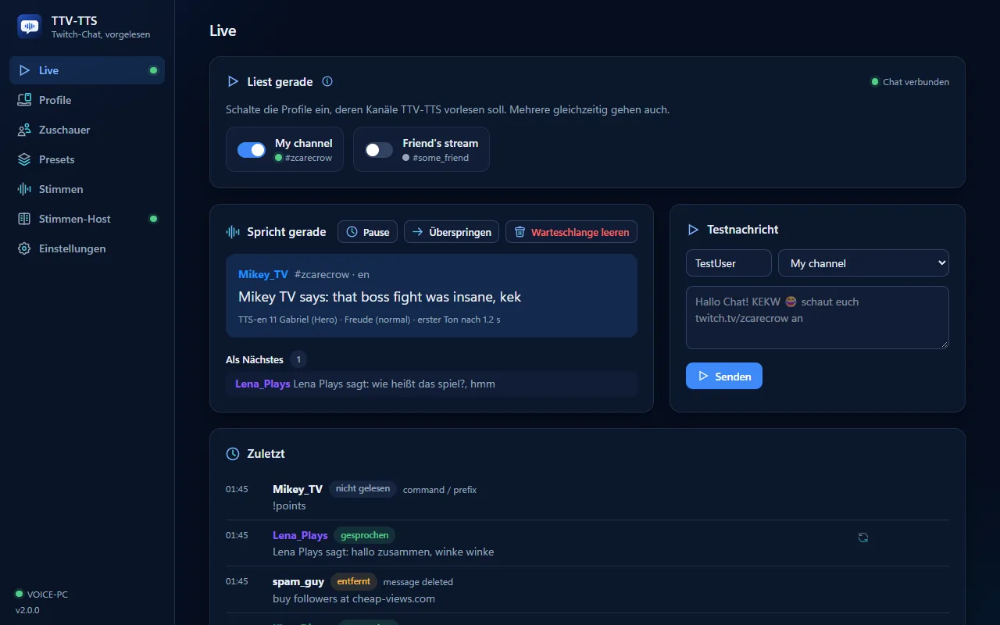

<h1 align="center">TTV-TTS</h1>

<p align="center"><b>Dein Twitch-Chat, vorgelesen in echten Stimmen – von Voice Creator Pro auf deiner eigenen Grafikkarte.</b></p>

<p align="center">
  <a href="https://github.com/ZcarecroW/TTV-TTS/releases/latest"></a>
  <a href="LICENSE.txt"></a>
  
</p>

<p align="center">
  <b><a href="https://zcarecrow.github.io/TTV-TTS/de/#download">⬇ Download</a></b> ·
  <b><a href="https://zcarecrow.github.io/TTV-TTS/de/">📖 Dokumentation</a></b> ·
  <a href="https://zcarecrow.github.io/TTV-TTS/de/#voices">🔊 Stimmen anhören</a> ·
  <a href="README.md">🇬🇧 English</a>
</p>



**TTV-TTS** ist eine kostenlose Desktop-App, die deinen Twitch-Chat vorliest. Die Stimmen kommen aus **[Voice Creator Pro](https://voicecreator.pro)** auf deiner eigenen Grafikkarte – auf deinem Streaming-PC oder auf einem zweiten PC mit dem kleinen **TTV-TTS Proxy**. Keine Cloud, kein Abo, keine Kosten pro Nachricht, keine Twitch-Anmeldung.

## Funktionen

- 🎭 **Jeder Zuschauer hat seine eigene Stimme** – und behält sie, in jeder Sprache.
- 🎬 **20 Presets mit je 240 Stimmen** (Fantasy Tavern, Starship Crew, Noir City …), einmal von Voice Creator Pro berechnet – oder fertig heruntergeladen, oder lass eine KI dein eigenes schreiben.
- 🌍 **Jede Sprache**: Jede Nachricht wird in ihrer Sprache vorgelesen oder für dich übersetzt.
- 😂 **Gefühle und Effekte**: Emotes und Emojis lassen Stimmen lachen oder weinen; Radio, Roboter, Höhle – plus deine eigenen **VST3- und CLAP**-Plugins.
- 🛡️ **Du behältst die Kontrolle**: Filter, Freigabe-Warteschlange, Überspringen und Wiederholen, globale Tastenkürzel, Mod-Befehle, eine Systemstimme, wenn der Grafik-PC aus ist.
- 🖥️ **Zwei PCs**: Der Proxy läuft neben Voice Creator Pro, koppelt sich mit einem sechsstelligen Code, verschlüsselt, mit Firewall-Prüfung – und startet Voice Creator Pro neu, wenn es langsam wird.
- 🎛️ **Stream Deck & Streamer.bot** über eine kleine lokale API.
- 🤝 **Freunde über das Internet**: Leih Freunden deine berechneten Stimmen, mit Einladungen und Tageslimits.
- 📦 **Stimmenpakete** zum Teilen berechneter Stimmen; **Ansagen** von Abos, Raids, Cheers (und Follows mit der optionalen Twitch-Anmeldung).

## Loslegen

1. **Installier** TTV-TTS von den [Versionen](https://github.com/ZcarecroW/TTV-TTS/releases/latest). Läuft Voice Creator Pro auf einem anderen PC, installier dort den TTV-TTS Proxy.
2. **Verbinden**: TTV-TTS findet Voice Creator Pro auf diesem PC oder koppelt sich mit dem Proxy.
3. **Wähl ein Preset** und lass seine Stimmen berechnen – oder lade sie fertig herunter.
4. **Trag deinen Kanal ein** und geh live.

Die **[Dokumentation](https://zcarecrow.github.io/TTV-TTS/de/)** (Deutsch und Englisch) erklärt jede Einstellung, die Firewall, OBS und mehr.

## Du kommst von TTV-TTS 1.x?

Deine 300 Stimmen aus 1.x werden als Preset *Classic 30* übernommen – nichts zu berechnen. Die OBS-Browserquelle von 1.x funktioniert weiter unter ihrer alten Adresse, wird aber nicht weiterentwickelt. Siehe **[Von 1.x umsteigen](https://zcarecrow.github.io/TTV-TTS/de/from-v1/)**.

## Bauen

Tauri 2 (Rust) und Vue 3. Siehe **[Aus dem Quellcode bauen](https://zcarecrow.github.io/TTV-TTS/de/building/)**:

```sh
npm ci
npm run tauri --workspace @ttv-tts/app -- dev
```

## Lizenz

Gemacht von **[ZcarecroW](https://twitch.tv/zcarecrow)**, veröffentlicht unter der [MIT-Lizenz](LICENSE.txt).

Die Icons sind von [Nucleo](https://nucleoapp.com), für den Autor für TTV-TTS lizenziert; sie fallen nicht unter die MIT-Lizenz und dürfen nicht herausgelöst oder anderweitig verwendet werden. TTV-TTS gehört nicht zu Twitch, mortartribe (Voice Creator Pro), BetterTTV, FrankerFaceZ oder 7TV; deren eigene Bedingungen gelten.
