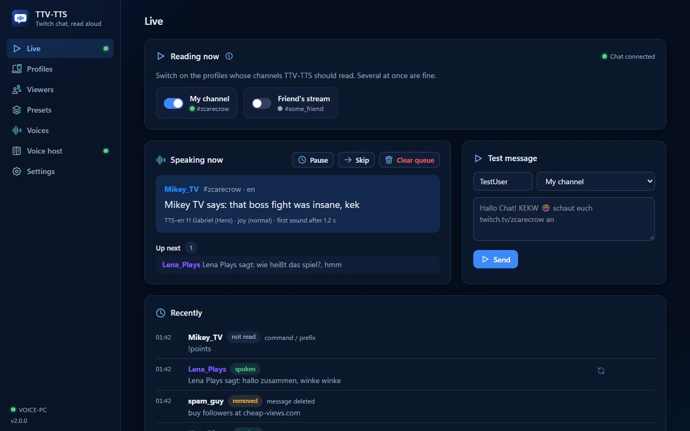

<h1 align="center">TTV-TTS</h1>

<p align="center"><b>Your Twitch chat, read aloud in real voices – by Voice Creator Pro on your own graphics card.</b></p>

<p align="center">
  <a href="https://github.com/ZcarecroW/TTV-TTS/releases/latest"></a>
  <a href="https://github.com/ZcarecroW/TTV-TTS/releases"></a>
  <a href="LICENSE.txt"></a>
  
</p>

<p align="center">
  <b><a href="https://zcarecrow.github.io/TTV-TTS/#download">⬇ Download</a></b> ·
  <b><a href="https://zcarecrow.github.io/TTV-TTS/">📖 Documentation</a></b> ·
  <a href="https://zcarecrow.github.io/TTV-TTS/#voices">🔊 Hear the voices</a> ·
  <a href="README.de.md">🇩🇪 Deutsch</a>
</p>



**TTV-TTS** is a free desktop app that reads your Twitch chat aloud. The voices come from **[Voice Creator Pro](https://voicecreator.pro)** running on your own GPU – on your streaming PC, or on a second PC with the small **TTV-TTS Proxy**. No cloud, no subscription, no cost per message, no Twitch login.

## Features

- 🎭 **Every viewer has their own voice** – and keeps it, in every language.
- 🎬 **20 presets with 240 voices each** (Fantasy Tavern, Starship Crew, Noir City …), computed once by Voice Creator Pro – or download them ready-made, or let an AI write your own.
- 🌍 **Every language**: each message is read in its own language, or translated for you.
- 😂 **Feelings and effects**: emotes and emojis make voices laugh or cry; radio, robot, cave – plus your own **VST3 and CLAP** plugins, also as random effects per viewer, and run on the voice host PC.
- 🛡️ **You stay in control**: filters, an approval queue, skip and replay, global hotkeys, mod commands, a system voice when the GPU PC is down.
- 🖥️ **Two PCs**: the proxy runs next to Voice Creator Pro, pairs with a six-digit code, encrypted, with a firewall check – and restarts Voice Creator Pro when it gets slow.
- 🎛️ **Stream Deck & Streamer.bot** through a small local API.
- 🤝 **Friends over the internet**: lend your computed voices to friends, with invites and daily limits – or as an OBS link they paste into OBS, encrypted with a free HTTPS certificate and the router ports opened automatically (DuckDNS, Let’s Encrypt, UPnP).
- 📦 **Voice packs** to share computed voices; **announcements** of subs, raids, cheers (and follows with the optional Twitch login).

## Get started

1. **Install** TTV-TTS from the [releases](https://github.com/ZcarecroW/TTV-TTS/releases/latest). If Voice Creator Pro runs on another PC, install the TTV-TTS Proxy there.
2. **Connect**: TTV-TTS finds Voice Creator Pro on this PC, or pairs with the proxy.
3. **Pick a preset** and compute its voices – or download them ready-made.
4. **Enter your channel** and go live.

The **[documentation](https://zcarecrow.github.io/TTV-TTS/)** (English and German) explains every setting, the firewall, OBS and more.

## Coming from TTV-TTS 1.x?

Your 300 voices from 1.x are adopted as the preset *Classic 30* – nothing to compute. The 1.x OBS browser source keeps working at its old address, but isn't developed further. See **[Coming from 1.x](https://zcarecrow.github.io/TTV-TTS/from-v1/)**.

## Building

Tauri 2 (Rust) and Vue 3. See **[Building from source](https://zcarecrow.github.io/TTV-TTS/building/)**:

```sh
npm ci
npm run tauri --workspace @ttv-tts/app -- dev
```

## License

Made by **[ZcarecroW](https://twitch.tv/zcarecrow)**, released under the [MIT License](LICENSE.txt).

The icons are from [Nucleo](https://nucleoapp.com), licensed to the author for TTV-TTS; they are not covered by the MIT license and may not be extracted or reused. TTV-TTS isn't affiliated with Twitch, mortartribe (Voice Creator Pro), BetterTTV, FrankerFaceZ or 7TV; their own terms apply.
