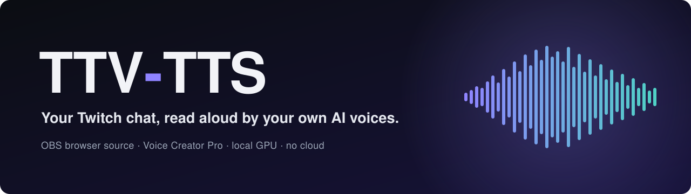
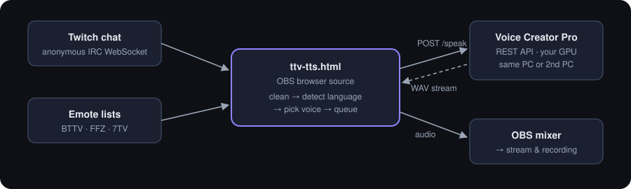

<p align="center">
  
</p>

<p align="center">
  <a href="https://github.com/ZcarecroW/ttv-tts/releases/latest"></a>
  <a href="https://github.com/ZcarecroW/ttv-tts/releases"></a>
  <a href="LICENSE.txt"></a>
  
  <a href="https://twitch.tv/zcarecrow"></a>
</p>

<p align="center">
  <b><a href="https://github.com/ZcarecroW/ttv-tts/releases/latest">⬇&nbsp;Download the pack</a></b>
  &nbsp;·&nbsp;
  <b><a href="https://zcarecrow.github.io/ttv-tts/readme.html">📖&nbsp;Full guide</a></b>
  &nbsp;·&nbsp;
  <a href="#quick-start">Quick start</a>
  &nbsp;·&nbsp;
  <a href="#troubleshooting">Troubleshooting</a>
</p>

---

**TTV-TTS** is an invisible OBS browser source that reads your Twitch chat aloud in each viewer's own language. The voices come from **[Voice Creator Pro](https://voicecreator.pro)** running locally on your own GPU. You get natural, consistent AI voices with no cloud service, no subscription, no Twitch login and no per-message cost.

It's a single HTML file. You drop it into OBS, enter your channel name, and your chat starts talking.

## Features

- 🔌 **Anonymous chat connection.** No Twitch login, token or bot account needed. It can read your chat but can't write to it.
- 🌍 **Language detection for every message.** It detects English, German, Russian, Ukrainian, French, Spanish, Italian, Portuguese, Dutch, Polish, Turkish, Japanese, Chinese and Korean, and recognizes several other writing systems. For short, unclear messages ("ok", "gg") it uses the language that viewer wrote in last.
- 🎭 **A fixed voice "role" per viewer.** Every viewer always gets the same character, spoken by a native voice in each language.
- 😂 **Emotes and emojis handled.** Twitch, BTTV, FFZ and 7TV emotes are read once (`KEKW KEKW KEKW` → "kek") or removed. Emojis become words (😂 → "laughing").
- 🧹 **Text cleanup.** It handles links, @mentions, letter spam ("sooooo"), ALL CAPS, abbreviations (`gg`, `brb`), blocked words and cheermotes.
- ⚡ **Low latency.** The first sound comes after about 0.7–0.9 s. The next message is generated while the current one is still playing.
- 🛡️ **Moderation.** Mods can use `!skip`, `!ttsclear`, `!ttspause`, `!ttsvol 50` and `!ttsmute name`. Timeouts, bans and deleted messages leave the queue automatically.
- 🔁 **Recovers on its own.** It reconnects automatically, warms up again after a VCP restart, primes brand-new voices by itself, and shows clear errors in debug mode.
- 🖥️ **Works with one PC or two.** A script makes VCP reachable from a second PC, and keeps it that way.

## How it works

<p align="center"></p>

1. The page joins your chat anonymously and loads your channel's emote lists.
2. Each message goes through filters (bots, commands, muted users). It is then split into words, emotes and emojis, its language is detected, and the text is cleaned up.
3. The page asks VCP to speak the text (`POST /api/v1/speak`) with the chosen voice and language.
4. The WAV stream is played through Web Audio *while VCP is still generating*. The sound goes straight into the OBS mixer and from there into your stream and recording.

## What's in the pack

| File | What it is | Where you use it |
|---|---|---|
| `ttv-tts.html` | The chat reader. Its settings are at the top of the file. | OBS browser source on the streaming PC |
| `readme.html` | The full guide and configuration reference ([online version](https://zcarecrow.github.io/ttv-tts/readme.html)). | Any browser |
| `connection-check.html` | Tests the whole chain step by step, plus a speech test with timing. | Browser on the streaming PC |
| `voice-lab.html` | Creates and checks a matching set of role voices in VCP (6 roles × your languages). | Any browser that can reach VCP |
| `vcp-lan-setup.ps1` | Makes VCP reachable from a second PC and keeps it that way across reboots. | The VCP PC (two-PC setups only) |
| `LICENSE.txt` | MIT license. | – |

## Requirements

- **[Voice Creator Pro](https://voicecreator.pro)** (Windows or macOS) with its **HTTP API** enabled. A GPU with about 8 GB VRAM is recommended (tested on an RTX 3070 8 GB).
- A streaming-capable model in VCP. **Qwen3-TTS** is recommended. It supports streaming, voice design and 10 languages.
- **OBS Studio** 30+ (tested with OBS 32).
- Internet access on the OBS PC for the Twitch chat and emote lists. VCP itself runs offline.

## Quick start

### A · Everything on one PC

1. **Download** `ttv-tts-pack-*.zip` from the [latest release](https://github.com/ZcarecroW/ttv-tts/releases/latest) and extract it, e.g. to `C:\TTS\`.
2. In **Voice Creator Pro**, download the Qwen3 model and enable the **HTTP API** in the settings (default port `8100`). Setting an API key is optional.
3. **Create voices:** open `voice-lab.html`, pick your languages and press **Start**. Or set a default agent voice in VCP and use `voices.mode: 'single'`.
4. **Configure:** open `ttv-tts.html` in a text editor and set at least:
   ```js
   twitch:   { channel: 'your_channel_name' },
   vcp:      { baseUrl: 'http://127.0.0.1:8100', apiKey: '' /* your key, if you set one */ },
   language: { default: 'en' },   // your chat's main language
   ```
5. **Test:** open `connection-check.html`, enter the URL, key and channel, and press **Run all checks**.
6. **OBS:** add a source → **Browser** → tick **Local file** → choose `ttv-tts.html`. Then tick **Control audio via OBS** and untick **Shutdown source when not visible**.
7. Write something in your chat. Done! 🎙️

### B · VCP on a second PC

1. Do step 2 above on the VCP PC.
2. Copy `vcp-lan-setup.ps1` to the VCP PC, right-click it → **Run with PowerShell** and confirm the admin prompt. It sets up a port proxy (`8101 → 8100`), a firewall rule and an autostart check, then prints the `baseUrl` to use.
3. On the OBS PC continue with steps 3–7, using `baseUrl: 'http://<IP of the VCP PC>:8101'`.

> [!TIP]
> If Windows blocks the script, open the downloaded ZIP's **Properties** → tick **Unblock** *before* extracting it.
> Using **Malwarebytes Windows Firewall Control**? Add the authorized group `VCP` first, otherwise WFC deletes the firewall rule (details in the [guide → Firewall](https://zcarecrow.github.io/ttv-tts/readme.html#firewall)).

## Configuration

Everything lives in `const CONFIG = { … }` at the top of `ttv-tts.html`, and every option has a comment. Some useful ones:

| Option | Default | What it does |
|---|---|---|
| `voices.mode` | `'perUserLanguage'` | Picks the voice: a fixed role per viewer in each language, a fixed voice per viewer (`'perUser'`), one voice per language (`'perLanguage'`) or always the same voice (`'single'`) |
| `reading.mode` | `'all'` | Reads every message, only `!tts …` messages (`'command'`) or only certain roles (`'privileged'`) |
| `reading.rewardId` | `''` | Reads only the messages from one channel-points reward |
| `names.announce` | `'onChange'` | Says "Max says: …" only when the speaker changes |
| `emotes.mode` | `'once'` | Reads each emote once, removes emotes, or keeps them |
| `vcp.playback` | `'stream'` | Switch to `'buffered'` if OBS crackles |
| `vcp.prebufferSec` | `2.0` | Lower values (e.g. `0.5`) start the sound sooner |

The full reference is in the guide: **[Configuration reference →](https://zcarecrow.github.io/ttv-tts/readme.html#config)**

## Chat commands

Broadcaster and moderators can use these by default (`modCommands.roles`). All command names can be changed.

| Command | Effect |
|---|---|
| `!skip` | Stop the current message |
| `!ttsclear` | Clear the queue |
| `!ttspause` / `!ttsresume` | Pause / resume reading (messages keep queueing) |
| `!ttsvol 50` | Set the volume to 0–100 % |
| `!ttsmute name` / `!ttsunmute name` | Mute / unmute a viewer (remembered) |

## Troubleshooting

Start with **`connection-check.html`**. It finds most problems and tells you how to fix each one. To see what's going on, open `ttv-tts.html?debug` in a normal browser: it shows a live status panel and log.

| Symptom | Fix |
|---|---|
| *VCP not reachable* | Start VCP, enable its HTTP API, check `baseUrl`. Two PCs: run `vcp-lan-setup.ps1 -Check` on the VCP PC. |
| Two PCs: *worked yesterday, not today* | A firewall manager deleted the rule, or the IP changed. See the [guide → Firewall](https://zcarecrow.github.io/ttv-tts/readme.html#firewall). |
| The log shows ▶ lines but the stream is silent | Turn on **Control audio via OBS**, and check that the source is in an active scene and not muted. |
| *Generation failed* with a new voice | Nothing to do. New voices are primed automatically, so their first message takes about 20 s longer. |
| Crackling or beeps | Set `vcp.playback: 'buffered'` or raise `vcp.prebufferSec`. |

There's much more in the **[full troubleshooting table →](https://zcarecrow.github.io/ttv-tts/readme.html#troubleshooting)**

## Security & privacy

- 🔑 **Your configured `ttv-tts.html` contains your API key and IP.** Don't share it or show it on stream. Share the original pack instead.
- 🚫 **Never** forward ports `8100`/`8101` from your router to the internet. The connection has no encryption (TLS).
- 👀 TTV-TTS only connects to the Twitch chat (anonymous, read-only), the public BTTV/FFZ/7TV emote lists and **your own** VCP. There's no tracking and no analytics, and your chat text never leaves your network.

## Contributing

Found a bug or have an idea? [Open an issue](https://github.com/ZcarecroW/ttv-tts/issues/new/choose). Please **remove your API key** from any logs you paste. Pull requests are welcome too.

## Credits & license

Made by **[ZcarecroW](https://twitch.tv/zcarecrow)** and released under the [MIT License](LICENSE.txt). You can use it, change it and share it, as long as you keep the copyright notice.

At runtime it uses [Voice Creator Pro](https://voicecreator.pro), Twitch chat, [BetterTTV](https://betterttv.com), [FrankerFaceZ](https://www.frankerfacez.com) and [7TV](https://7tv.app). This project isn't affiliated with any of them, and their own terms apply.
